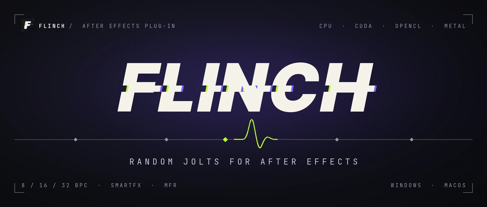
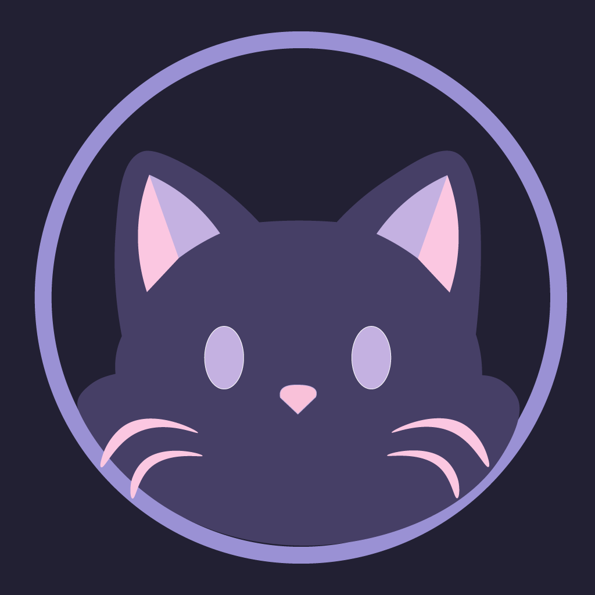
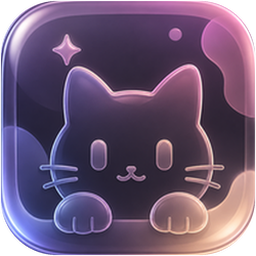
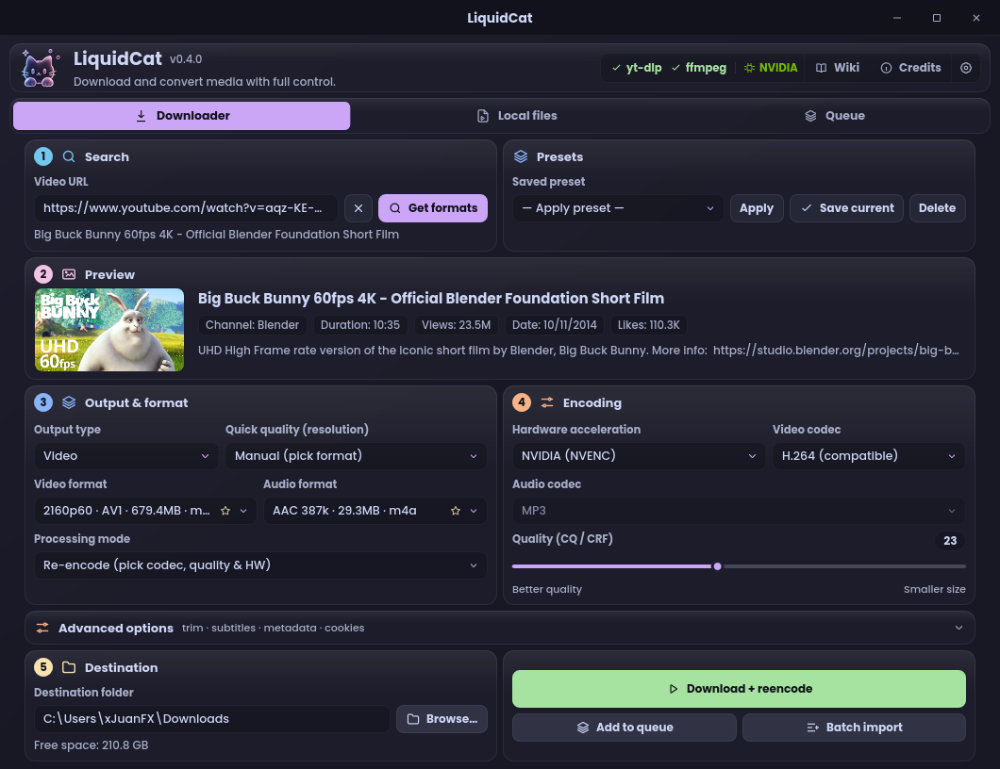

  

  
  
  

Hey, I'm **JuanFX** 👋 — a motion designer who got curious about what happens
*inside* the tools. These days that means writing After Effects plugins in C++
with GPU rendering and shipping desktop apps with **[Kittora](https://github.com/Kittora)** — and in
between I make intros and beats as **prodxvex**.

## ⚡ Now building: Flinch

**[Flinch](https://github.com/xjuanfxx/flinch)** is an After Effects effect that adds short, random,
involuntary-looking jolts to a layer — **blur, color, light, scale, slide and time**
twitches that fire on their own and ease in and out over a few frames.

- 🎛️ Six operators, each with its own controls and seed; deterministic, repeatable renders
- 🚀 GPU rendering written once and compiled for **CUDA**, **OpenCL** and **Metal**, with CPU fallback
- 🎨 8, 16 and 32-bit float color, SmartFX and multi-frame rendering
- 💻 Windows x64 and macOS universal (Apple Silicon + Intel)

  
  
  
  

## 🐾 Kittora

<table>
  <tr>
    <td width="120" align="center" valign="middle">
      
    </td>
    <td valign="middle">
      <b><a href="https://github.com/Kittora">Kittora</a></b> is where I build tools with <a href="https://github.com/notTao">Adaki</a>: <i>small tools for creators, built with care.</i>
      No bloatware, no unnecessary telemetry — just good UX and attention to detail.
      The focus right now is multimedia: downloading, converting and editing.
    </td>
  </tr>
</table>

### 🐱 LiquidCat

<table>
  <tr>
    <td width="120" align="center" valign="top">
      
    </td>
    <td valign="top">
      <b><a href="https://github.com/Kittora/LiquidCat">LiquidCat</a></b> is a native desktop app to <b>download, convert and re-encode</b> media,
      powered by <code>yt-dlp</code> and <code>FFmpeg</code>. A from-scratch rewrite in <b>Rust + Slint</b> — no WebView, one small executable.
        
      
      
      
    </td>
  </tr>
</table>

- ⚡ GPU encoding across vendors: **NVENC, AMF, Quick Sync, VAAPI, VideoToolbox**
- 📥 Batch import, job queue and history, subtitles, thumbnails and metadata
- ✂️ Trim segments without leaving the app
- 🎨 14 themes and 6 languages

## 🧰 Toolbox

  

## 🗂️ Other things I've made

| | |
|---|---|
| 🎞️ **[Flinch](https://github.com/xjuanfxx/flinch)** | Random jolts for After Effects — CPU + GPU (CUDA, OpenCL, Metal) |
| 🐱 **[LiquidCat](https://github.com/Kittora/LiquidCat)** | Download, convert and re-encode media — Rust + Slint, with Kittora |
| 📸 **[JuanFX-Lightroom](https://github.com/xjuanfxx/JuanFX-Lightroom)** | Version history and updates for my Lightroom presets |
| 🔊 **[YouTube Loudness Unchained](https://github.com/xjuanfxx/yt-loudness-unchained)** | Userscript that turns off YouTube's volume normalization — hear the original master |

## 📊 Activity

  
  

Cards are rendered by this repo's own <a href=".github/workflows/cards.yml">workflow</a> every day — no third-party image services.
