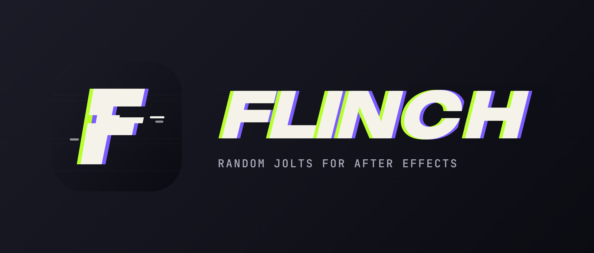

  

  
  
  

Hey, I'm **JuanFX** 👋 — a motion designer who got curious about what happens
*inside* the tools. These days that means writing After Effects plugins in C++
with GPU rendering, and in between I make intros and beats as **prodxvex**.

## ⚡ Now building: Flinch

**[Flinch](https://github.com/xjuanfxx/flinch)** is an After Effects effect that adds short, random,
involuntary-looking jolts to a layer — **blur, color, light, scale, slide and time**
twitches that fire on their own and ease in and out over a few frames.

- 🎛️ Six operators, each with its own controls and seed; deterministic, repeatable renders
- 🚀 GPU rendering written once and compiled for **CUDA**, **OpenCL** and **Metal**, with CPU fallback
- 🎨 8, 16 and 32-bit float color, SmartFX and multi-frame rendering
- 💻 Windows x64 and macOS universal (Apple Silicon + Intel)

  
  
  
  

## 🧰 Toolbox

  

## 🗂️ Other things I've made

| | |
|---|---|
| 🎞️ **[Flinch](https://github.com/xjuanfxx/flinch)** | Random jolts for After Effects — CPU + GPU (CUDA, OpenCL, Metal) |
| 📸 **[JuanFX-Lightroom](https://github.com/xjuanfxx/JuanFX-Lightroom)** | Version history and updates for my Lightroom presets |
| 😀 **[EmojiReplace](https://github.com/xjuanfxx/EmojiReplace)** | Swap Discord's emojis for another provider's (Apple, Facebook…) |

## 📊 Activity

  
  

Cards are rendered by this repo's own <a href=".github/workflows/cards.yml">workflow</a> every day — no third-party image services.
